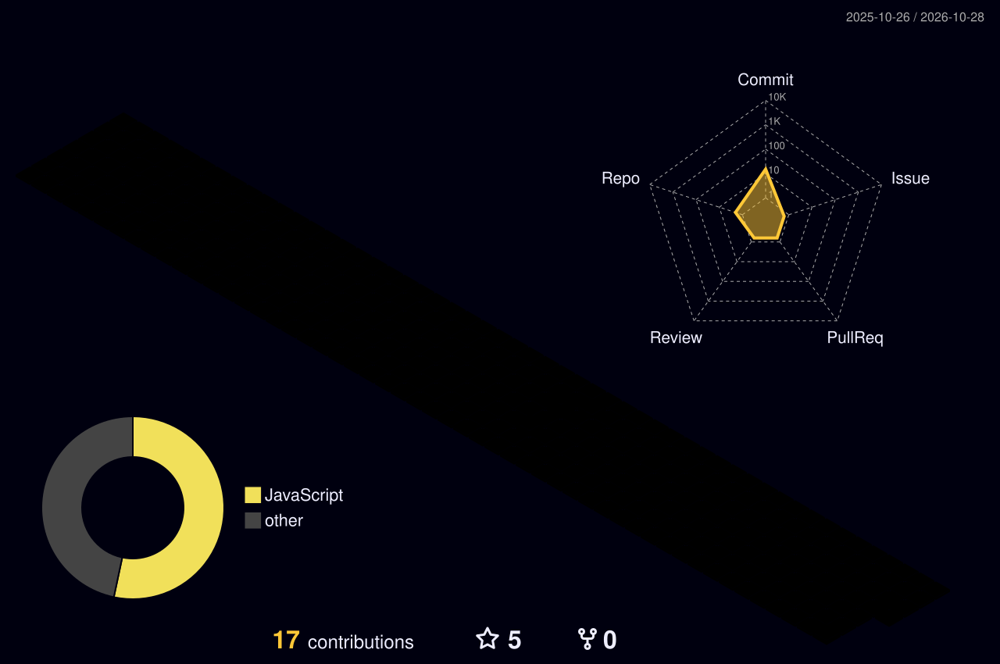

<!-- ===================== HEADER ===================== -->
<div align="center">


<a href="https://git.io/typing-svg">
  
</a>

<br/><br/>


</div>


## 👨‍💻 About Me

<table>
<tr>
<td width="55%">

```js
const rohit = {
  name: "Rohit Kumar Shrivas",
  role: "Software Development Engineer",
  location: "India 🇮🇳",
  languages: ["C++", "Python", "JavaScript"],
  frontend: ["HTML", "CSS", "React", "Tailwind"],
  database: ["MongoDB"],
  ai: ["GenAI", "RAG", "LangChain", "LLMs"],
  strongAt: ["DSA", "DBMS", "OS", "Networks"],
  askMeAbout: "CS fundamentals",
  status: "Always learning 🚀",
};
```

</td>
<td width="45%">

- 🌱 Proficient in **C++, Python, HTML, CSS, JavaScript, React JS, Tailwind CSS, MongoDB**
- 🤖 Exploring **Generative AI, RAG, LangChain and LLM-powered apps**
- 💬 Ask me about **DBMS, OS, Computer Networks**
- 🧩 I solve problems on LeetCode, CodeChef, HackerRank and GfG
- 📫 **[rshrivas373@gmail.com](mailto:rshrivas373@gmail.com)**

</td>
</tr>
</table>


## 🛠️ Tech Stack

<div align="center">

<a href="https://skillicons.dev">
  
</a>

<br/><br/>

### 🤖 AI / ML & Generative AI


<br/><br/>


</div>


## 🧊 3D Contribution Graph

<div align="center">
  
</div>

## 🐍 Contribution Snake

<div align="center">
  <picture>
    <source media="(prefers-color-scheme: dark)" srcset="https://raw.githubusercontent.com/ryzen234/ryzen234/output/github-snake-dark.svg" />
    <source media="(prefers-color-scheme: light)" srcset="https://raw.githubusercontent.com/ryzen234/ryzen234/output/github-snake.svg" />
    
  </picture>
</div>


## 📊 GitHub Stats

<div align="center">


<br/>


</div>


## 🧠 Competitive Programming

<div align="center">

[](https://www.leetcode.com/ryzen234)
[](https://www.codechef.com/users/ryzen678)
[](https://www.hackerrank.com/@rshrivas7267)
[](https://auth.geeksforgeeks.org/user/rshrivuill)

</div>


## 🤝 Let's Connect

<div align="center">

[](https://linkedin.com/in/rohit-kumar-shrivas)
[](https://instagram.com/_rohit+shrivas____)
[](mailto:rshrivas373@gmail.com)

<br/>


</div>
